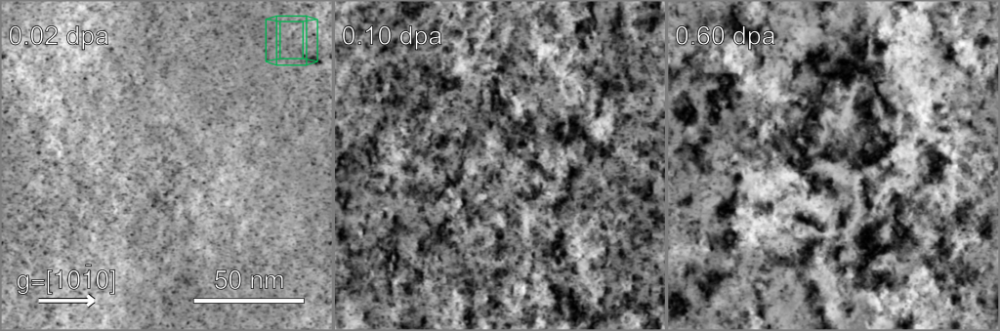

# Quick start



hbtem-cp is a code to create simulated TEM images of large atomic simulations in the Howie-Basinski ( many beam ) approximation using a complex-phase representation of the distortion field.

Expanding the Schrödinger equation to first order in spatial derivatives as a sum of beams with wavevectors 
\mathbf{k} + \mathbf{g},
gives 

```math
\frac{( \mathbf{k} + \mathbf{g} )}{|\mathbf{k}|}  \cdot \nabla \phi_{\mathbf{g}}(\vec{r}) 
=
-i\, \sum_{\mathbf{g'}} \mathbf{M}_{\mathbf{g},\mathbf{g'} }(\vec{r}) \phi_{\mathbf{g'}}(\vec{r})
```

where the propagation matrix is expressed as the sum of two parts:
1. propagation through vacuum is handled by the deviation parameter 
$ s_{\mathbf{g}} $,
and 
2. propagation through the crystal requires an "on/off" density function 
$ \rho(\vec{r} \in [0,1] $, 
a complex extinction distance 
$ \xi_{\mathbf{g}} $, 
and a complex phase factor representing the distortions in the lattice, 
$ x_{\mathbf{g}}(\vec{r}) = \exp[ -i \mathbf{g}.\mathbf{u}(\vec{r}) ] $
.

$$
\mathbf{M}_{\mathbf{g},\mathbf{g'} }(\vec{r}) 
=
2 \pi \delta_{\mathbf{g},\mathbf{g'}}  s_{\mathbf{g}}  + \pi  \rho(\vec{r}) \,  \frac{x_{\mathbf{g}-\mathbf{g}'}(\vec{r})}{\xi_{\mathbf{g}-\mathbf{g}'} }.
$$


## compilation for mpi executable 

Check for a matching pair of mpi fortran/c compilers- mine are mpiifort/mpiicc, and then
```
mkdir build ; cd build

cmake ../. -DCMAKE_Fortran_COMPILER=mpiifort -DCMAKE_C_COMPILER=mpiicc -DCMAKE_SERIAL=False

make 
```

## first run

```
./bin/run_SimulatedTEM
```

should give a list of runtime options.

## typical run

```
./bin/run_SimulatedTEM -f inputFe.xyz -g 2,0,0 -a0 2.8665 
```

where inputFe.xyz is an extended xyz format file containing Fe atoms, with an [001] axis in the z-direction, and lattice parameter 2.8665A.

## supported input files

Currently, the only input files supported are
```
extended .xyz
parcas .xyz
lammps write_data format
```
TODO: I do not support lammps dump files. This could be vibe coded fairly easily?


## references

The Howie-Basinski equations are described in 

Z. Zhou et al "Simulations of weak-beam diffraction contrast images of dislocation loops by the many-beam Howie–Basinski equations", Phil Mag 28:4851-4881 (2006) doi: 10.1080/14786430600615041

The complex phase factor is described in

D.R. Mason et al "Simulated TEM imaging of a heavily irradiated metal", Acta Mater 277:120162 (2024)
doi: 10.1016/j.actamat.2024.120162

Computation of the extinction distance is described in 

S.L. Dudarev et al "On the Doyle-Turner representation of the optical potential for RHEED calculations", Surface Science 330 (1995) 86-100 
doi: 10.1016/0039-6028(95)00464-5

L-M Peng et al "Debye–Waller Factors and Absorptive Scattering Factors of Elemental Crystals" Acta Cryst (1996) A52: 456-470
doi: 10.1107/S010876739600089X

# Licence

This code is not open source.

Copyright is retained by United Kingdom Atomic Energy Authority.
Daniel Mason daniel.mason@ukaea.uk
(c) UKAEA 2026
Permission is not given for this code to be copied, exploited, or used in training AI models without written consent of the author or UKAEA.

To obtain further information on the data and models underlying this work please contact PublicationsManager@ukaea.uk.


## matching up to ovito's dxa file

The box of atoms is tilted in order to give good diffraction conditions, so you never quite look down a zone axis. 
You can dump the atoms present in the image in their tilted positions using -opxyz.
Note that the atom box no longer has periodic boundary conditions after tilting, so you may want to toggle PBC off in ovito too.

TODO: Only works in serial run at the moment- I'd need to gather all the atoms onto rank=0 to get this to work in parallel.


## Specifying the lattice

The lattice parameter and lattice type will be set automatically by atom type. These defaults can be overridden using
```
    -a0  a
    -a0  a,b,c
    -lattice [bcc/fcc/hcp]
```
The orientation of the atoms is an expensive calculation. If the atoms are not in the orientation such that the input file "x" direction is [100], and y = [010], z = [001], then this needs to be input.
Use 
```
    -U uxx,uyx,uzx,uxy,uyy,uzy,uxz,uyz,uzz
```
To define the crystal lattice vector [uvw] to point in the space direction [xyz].
```
    ( x )   ( uxx uxy uxz )( a1 b1 c1 )( u )
    ( y ) = ( uyx uyy uyz )( a2 b2 c2 )( v )
    ( z )   ( uzx uzy uzz )( a3 b3 c3 )( w )
```
where [a1,a2,a3] is the lattice vector direction in the unrotated frame. 
For cubic crystals 
```
    ( a1 b1 c1 )      ( 1 0 0 )    
    ( a2 b2 c2 ) = a0 ( 0 1 0 )  
    ( a3 b3 c3 )      ( 0 0 1 )
```
For hcp  
```
    ( a1 b1 c1 )      ( 1/2         1/2     0       )
    ( a2 b2 c2 ) = a0 ( √(3/4)   -√(3/4)    0       )
    ( a3 b3 c3 )      (  0          0       √(8/3)  )
```

## Diffraction patterns

Generate intensities at the diffracted beams using -opDP. 
Note that this is not a true diffraction pattern- as the intensity is only calculated at a set of predetermined g-vector points and not everywhere.
The intensity and size of spots are indicative only, these patterns can be used to check if we are in sensible diffraction conditions, rather than being intended for analytic work.

Four files are produced:

_before.diff.png        is the intensity at the g-vector positions at an idealised (defect free) foil back surface before rotating the foil.
_max.diff.png           is the maximum intensity anywhere in an idealised (defect free) . It is used in many beam mode to check where the energy is.
_ready.diff.png         is the intensity at the g-vector positions at an idealised (defect free) foil back surface after rotating the foil.
_after.diff.png         is the intensity at the g-vector positions actually used in the full calculation, using the atom positions used in the full calculation.

### -tilt

To check these diffraction patterns look good before starting the full run, the flag -tilt can be used to stop the run after this step before generating the full image.


##  Setting a diffraction condition

The diffraction condition can be set in a number of ways. 

It is required to set a g-vector to focus on, with
```
    -g h,k,l
    -g h,j,k,l
```
where [hkl] is the Miller index ( or [hjkl] Miller-Bravais index for hcp ).

Then we can set which diffraction spot is selected to be brightest ( two beam conditions ), using 
``` 
    -ng 4
``` 
Default -ng 1. The foil is tilted until spot ng*[hkl] is brightest. 
If the diffraction pattern does not show this spot clearly bright, try changing the tilt search range to maximum tilt stage angle theta (degrees) and with ntilt samples.
```
    -ntilt int
    -theta float
```

Then we decide which beam is used to make the image.
In -dark mode, the image is taken at [hkl].
In -bright mode, the image is taken at [000].

### Advanced options

#### Memory issues?

The calculation is split into blocks across processors, but can still hit memory issues in many-beam mode.
The easiest way to set the amount of calculation held at any one time is to limit the slicing in the z-direction- use 
```
    -zlayers 20
```
or even lower if necessary to compute the complex phase field in 20 layer chunks.

#### Tilt foil by hand
Tilt the foil by hand using -R, example set no tilt with
```
    -R 1,0,0,0,1,0,0,0,1
```
This can also be used to tilt in the direction of the g-vector, which will force a value for s_g.

#### All beams "cheap STEM"
Use all beams (except [000]) to construct the image, instead of just one with -all.
Note this will remove the tilt ( equivalent to -R 1,0,0,0,1,0,0,0,1 ). This option is intended to be a quick-and-dirty approximation to STEM... but be warned that 'all beams' in this code only means the selected points in the diffraction pattern and not truly 'all'.


#### Precession 
Remove the exaggerated effect of small changes in s_g by precessing the beam with a small additional tilt angle.
```
    -nPrecAngle int 
    -precAngle float
```
A good selection is -nPrecAngle 10 -precAngle 0.03


